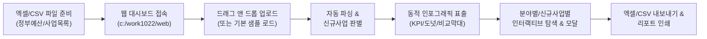
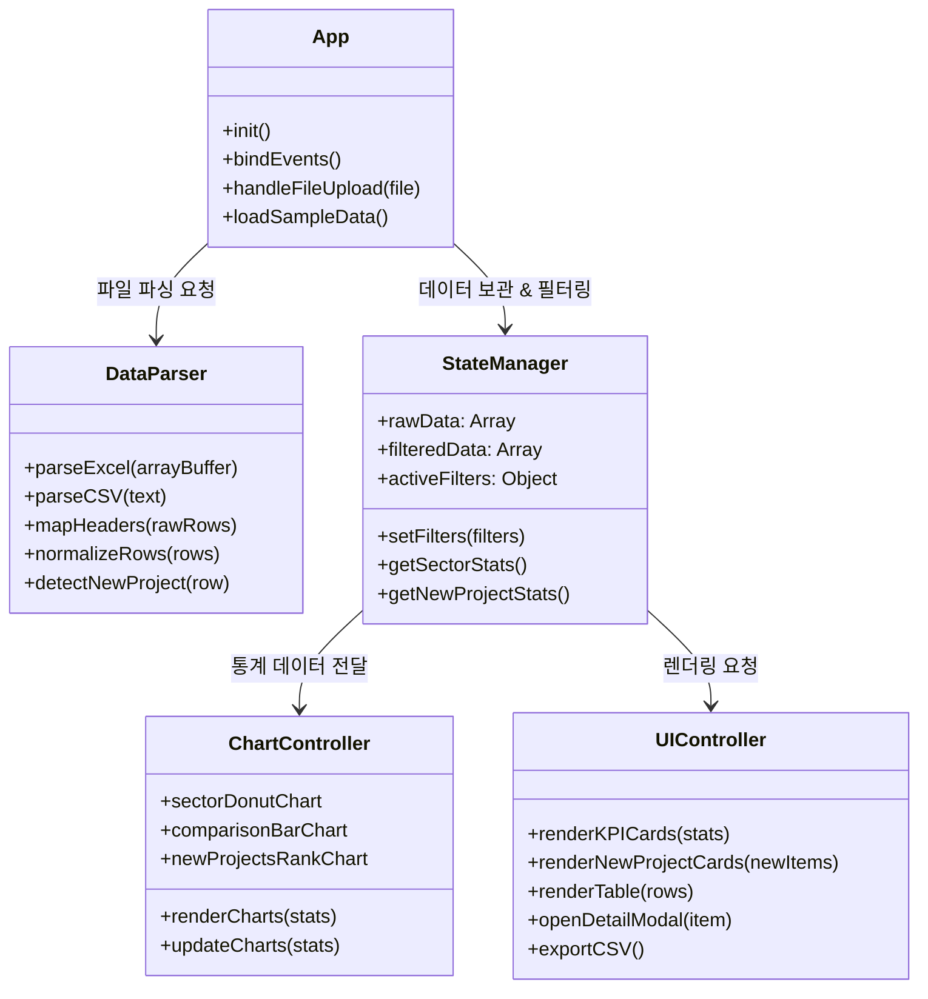
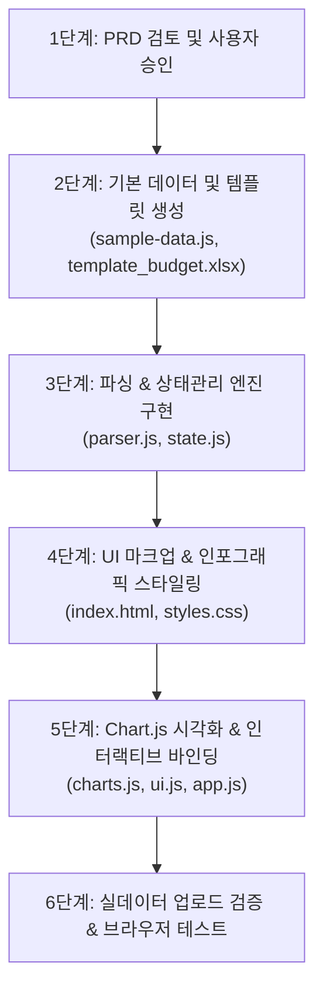

# 📋 [PRD] 분야별·신규사업별 예산 분석 인포그래픽 대시보드
**Product Requirements Document (PRD)**

---

## 1. 문서 및 프로젝트 개요

| 항목 | 내용 |
|---|---|
| **프로젝트명** | 분야별·신규사업별 예산 분석 인터랙티브 인포그래픽 대시보드 (Budget & Initiative Dashboard) |
| **버전** | v1.0.0 |
| **작성일자** | 2026-10-22 |
| **작업 위치** | `c:\work1022\web/` |
| **기술 스택** | Pure HTML5, CSS3, Vanilla JavaScript (ES6+), SheetJS (XLSX), Chart.js |
| **실행 방식** | Zero-Build (별도 빌드 도구 없이 브라우저에서 `index.html`을 열어 즉시 구동) |

### 1.1 배경 및 목적
- 정부 및 공공기관의 예산안·중점투자사업 데이터는 주로 엑셀이나 CSV 형태로 배포되나, 방대한 행과 복잡한 텍스트로 인해 **"분야별 투자 비중"**과 **"어떤 신규 사업이 새롭게 시작되는지"**를 한눈에 파악하기 어렵습니다.
- 본 프로젝트는 사용자가 제공한 엑셀/CSV 파일(예: 2027년 국방예산 중점투자사업 현황 등)을 업로드하기만 하면, 브라우저에서 즉시 파싱하여 **분야별 점유율/변화율** 및 **신규 사업(신설·착수 사업) 하이라이트**를 동적 인포그래픽과 인터랙티브 차트로 시각화하는 대시보드 웹 애플리케이션을 구축하는 것을 목표로 합니다.

---

## 2. 대상 사용자 및 핵심 유즈케이스



### 2.1 사용자 페르소나
- **정책 및 예산 기획 담당자**: 방대한 예산 항목 중 신규 도입 사업과 중점 분야별 비중을 신속하게 파악하고 보고용 자료를 도출하려는 사용자.
- **국방/공공 사업 분석가 & 연구원**: 전년 대비 증감액, 증가율 추세 및 사업별 추진 근거 원문을 교차 검증하려는 사용자.
- **의사결정자 및 대외 관계자**: 복잡한 수치 대신 직관적인 인포그래픽과 차트를 통해 핵심 포인트를 브리핑받고자 하는 사용자.

### 2.2 핵심 유즈케이스 (User Stories)
1. **파일 업로드 및 즉시 시각화**: 사용자는 복잡한 설치 없이 브라우저에서 엑셀 파일(.xlsx, .xls) 또는 CSV 파일을 끌어다 놓으면, 1초 내로 전체 대시보드가 자동으로 갱신되어야 한다.
2. **신규 사업(New Project) 집중 모니터링**: 2026년 예산이 0원이거나 '순증/신규'로 표시된 사업들을 시스템이 자동으로 분류하여, 전용 인포그래픽 카드와 랭킹 차트로 집중 조명해야 한다.
3. **분야별(중점영역) 투자 지형도 파악**: 분야별(예: 자주국방, AI·유무인, 인력구조, 방위산업 등) 총 예산 규모와 전년대비 증감률을 도넛 차트와 수평 비교 차트로 파악할 수 있어야 한다.
4. **인터랙티브 크로스 필터링**: 특정 분야 카드를 클릭하거나 "신규 사업만 보기" 토글을 켜면 차트, KPI 카드, 데이터 목록이 즉시 연동 필터링되어야 한다.
5. **사업 세부정보 원문 확인**: 목록의 개별 사업을 클릭하면 '보도자료 원문 근거', '지표 설명', '전년대비 변화율 게이지'가 담긴 세부 모달 창이 표시되어야 한다.

---

## 3. 입력 데이터 사양 및 파싱 규칙

### 3.1 9대 표준 데이터 컬럼 명세 (사용자 제공 서식 기준)

| 컬럼 번호 | 표준 컬럼명 | 데이터 타입 | 필수 여부 | 예시 값 | 비고 / 설명 |
|:---:|:---|:---:|:---:|:---|:---|
| **A** | `연번` | Number/String | 선택 | `1`, `01`, `15` | 식별 번호 (누락 시 1부터 자동 부여) |
| **B** | `분야 (중점영역)` | String | **필수** | `① 자주국방 & 전작권 전환`, `AI·유무인 복합체계` | 상위 범주 (차트 그룹핑 기준) |
| **C** | `세부 사업 / 주요 지표` | String | **필수** | `전작권 전환 및 자주국방 핵심전력 확보` | 단위 사업명 및 지표명 |
| **D** | `구분/단위` | String | 선택 | `억원`, `만원`, `원`, `명`, `대` | 지표 단위 (기본값: '억원') |
| **E** | `2026년 (A)` | Number | **필수** | `90222`, `87`, `0` | 전년도 예산액 (숫자, 콤마 자동 정제) |
| **F** | `2027년 정부안 (B)` | Number | **필수** | `121744`, `256`, `430` | 당해년도(정부안) 예산액 |
| **G** | `증감 (B-A)` | Number | 선택 | `31522`, `169`, `430` | 미기재 시 `B - A`로 자동 계산 |
| **H** | `증가율 (%)` | Number/String | 선택 | `34.9%`, `194.3%`, `순증/신규` | 미기재 시 `(B-A)/A*100` 자동 계산 |
| **I** | `핵심 내용 및 보도자료 박스 원문 근거` | String | 선택 | `KF-21 양산, 핵추진잠수함 착수 등` | 사업 상세 설명 및 정책 근거 |

### 3.2 유연한 헤더 매핑 규칙 (Fuzzy Header Matching)
업로드되는 파일마다 헤더 명칭이 미세하게 다를 수 있으므로, 정규식을 통해 자동 매핑합니다:
- **분야**: `/분야|중점영역|영역|부문|category|field/i`
- **사업명**: `/사업|세부.*사업|주요.*지표|프로젝트|project|item|name/i`
- **단위**: `/단위|구분|unit/i`
- **전년도**: `/2026|전년|이전|past|prior|A\b/i`
- **당해년도**: `/2027|정부안|당해|금년|current|target|B\b/i`
- **증감액**: `/증감\(|증감액|변동|차이|diff|change/i`
- **증가율**: `/증가율|증감률|비율|변화율|ratio|rate|%/i`
- **핵심내용**: `/핵심.*내용|보도자료|비고|근거|설명|비고.*특이사항|desc|note/i`

### 3.3 '신규 사업(New Project)' 자동 판정 알고리즘
다음 조건 중 **하나 이상**을 만족하는 사업은 자동으로 `isNew: true` 뱃지를 부여하고 신규 사업 인포그래픽 풀에 편입합니다:
1. **예산 기준**: 전년도(`2026년`) 예산이 `0`이거나 빈 문자열/Null인 경우 (예: 전년도 0 -> 올해 430억원)
2. **증가율 기준**: 증가율 컬럼의 값이 `"순증"`, `"신규"`, `"NEW"`, `"신설"` 등의 텍스트이거나 무한대(`Infinity`)인 경우
3. **텍스트 키워드 기준**: 사업명 또는 핵심 내용 컬럼에 `"신규"`, `"신설"`, `"착수"`, `"시범도입"` 키워드가 포함된 경우

---

## 4. 대시보드 화면 구성 및 UI/UX 설계

### 4.1 전체 레이아웃 와이어프레임

```
+--------------------------------------------------------------------------------------------------+
|  [LOGO] 2027 정부예산안 인터랙티브 인포그래픽 대시보드        [샘플 데이터] [양식 다운로드] [리포트 인쇄] |
+--------------------------------------------------------------------------------------------------+
|  [ 파일 업로드 드롭존: .xlsx, .xls, .csv 파일을 끌어놓거나 클릭하여 업로드하세요 (현재: sample.xlsx) ]    |
+--------------------------------------------------------------------------------------------------+
|                                    <<< KPI 요약 인포그래픽 카드 >>>                                 |
|  [ 1. 총 예산 규모 (2027) ]   [ 2. 전년대비 총 증감 ]    [ 3. 신규사업 집중 지표 ]  [ 4. 최대 증액/급증 사업 ] |
|     14.2조 원 (+33.8% ↑)        +3조 6,102억 원             9개 사업 / 1,484억원       KF-21 양산 (+3.1조원)   |
+--------------------------------------------------------------------------------------------------+
|                                    <<< 인포그래픽 차트 영역 >>>                                    |
|  [차트 1] 분야별 예산 점유율 (도넛)     | [차트 2] 분야별 전년 대비 비교 (2026 vs 2027 막대)              |
|  - 자주국방 78.4%                     | - 자주국방: 90,222억 -> 121,744억                                 |
|  - AI·유무인 5.0%                     | - AI·유무인: 4,968억 -> 7,727억 (+55.5%)                          |
|  - 드론/대드론 5.2%                   |                                                                  |
+--------------------------------------------------------------------------------------------------+
|  [차트 3] 신규 도입 사업 TOP 랭킹 (수평막대) | [인포그래픽 갤러리] 2027 신설·착수 사업 하이라이트 덱          |
|  1. 피지컬 AI 실증 (430억)            |  * 피지컬 AI 실증: 다족로봇 200대, 휴머노이드 실증                  |
|  2. 초급간부 기본급 개선 (316억)        |  * 대드론건 신규확보: 8종 대드론 장비 신규 확보                    |
|  3. 휴대용 대드론건 (291억)           |  * 단기복무 부사관 적금: 9,600명 매칭 지원                         |
+--------------------------------------------------------------------------------------------------+
|  [필터 바] [검색어 입력... ] [분야: 전체 V] [단위: 전체 V] [✔ 신규 사업만 보기] [정렬: 예산순 V] [테이블/카드 뷰] |
+--------------------------------------------------------------------------------------------------+
|                                    <<< 인터랙티브 데이터 테이블 >>>                                 |
|  연번 | 분야        | 세부 사업명                | 단위 | 2026년 | 2027년 | 증감   | 증가율  | 신규여부 |
|   1  | 자주국방     | 전작권 전환 핵심전력 확보    | 억원 | 90,222 | 121,744| +31,522| +34.9%  | [기존]   |
|   9  | AI·유무인   | 피지컬 AI 실증사업 신설     | 억원 |      0 |    430 |   +430 |  순증   | [NEW]   |
|  ... (행 클릭 시 세부 사업 팝업 모달 표시)                                                          |
+--------------------------------------------------------------------------------------------------+
```

### 4.2 핵심 컴포넌트별 상세 기능

#### ① 상단 인포그래픽 요약 카드 (KPI Cards)
- **총 사업 예산(2027)**: 억원 단위 사업들의 합산 금액 표시 및 전년대비 총 증감률 배지.
- **전년 대비 순증액**: 전년 총합 대비 증가한 순금액(+3조 6,102억원 등) 및 상승 그래프 아이콘.
- **신규 사업 집중 요약**: 전체 사업 중 신규로 분류된 사업 개수, 신규 사업 배정 총액, 전체 대비 신규 비중(%).
- **주요 스포트라이트**: 증액 규모 1위 사업(예: 전작권 전환 및 자주국방) 및 최고 증가율 사업(예: 상비예비군 운영 +194.3%).

#### ② 비주얼 인포그래픽 차트 4종
1. **분야별 점유율 도넛 차트 (Chart.js Doughnut)**:
   - 각 분야(중점영역)별 2027년 예산 총합을 도넛 차트로 렌더링.
   - 섹터 클릭 시 해당 분야 데이터만 대시보드 전체에 크로스 필터링(Cross-filtering) 적용.
2. **분야별 전년 vs 당해 비교 막대 차트 (Chart.js Grouped Bar)**:
   - 분야별로 2026년(A)과 2027년 정부안(B)을 나란히 배치하여 성장 폭을 시각화.
3. **신규 사업 TOP 5 랭킹 차트 (Chart.js Horizontal Bar)**:
   - 2027년에 신설된 사업 중 예산 규모가 큰 상위 사업들을 수평 막대로 직관적 비교.
4. **신규 사업 하이라이트 인포그래픽 카드 갤러리**:
   - 신규 사업들만 모아 시각적 카드 형태로 진열 (예산 배정액, 소관 분야 뱃지, 핵심 세부내용 요약 태그).

#### ③ 스마트 데이터 탐색기 & 인터랙티브 테이블
- **실시간 검색**: 사업명, 분야명, 비고 텍스트를 입력 즉시 실시간 필터링.
- **분야별 셀렉터**: 업로드된 데이터 내 고유 분야 목록을 동적으로 추출하여 셀렉트 옵션 구성.
- **신규 사업 전용 토글 스위치 (NEW ONLY)**: 클릭 한 번으로 신규 사업들만 즉시 모아보기.
- **단위 필터**: 금액(억원/만원/원)과 비금액(명, 대 등)을 분리하여 정합성 있는 비교 가능.
- **인터랙티브 모달 팝업**:
  - 테이블 행이나 인포그래픽 카드를 클릭하면 상세 레이어 팝업 오픈.
  - 전년대비 증감 게이지, 세부 사업 설명, `핵심 내용 및 보도자료 박스 원문 근거` 전문을 읽기 쉽게 표시.

---

## 5. 기술 스택 및 아키텍처



### 5.1 디렉터리 및 파일 구조 (`c:\work1022\web/`)
```
c:\work1022\web/
├── index.html               # 메인 대시보드 단일 페이지 마크업
├── PRD.md                   # 본 제품 요구사항 정의서
├── css/
│   └── styles.css           # 모던 디자인 시스템, 다크/라이트 테마, 인포그래픽 카드 스타일
├── js/
│   ├── app.js               # 애플리케이션 진입점 및 이벤트 총괄
│   ├── parser.js            # 엑셀/CSV 파서, 컬럼 매핑, 데이터 정규화 및 신규사업 판정 엔진
│   ├── state.js             # 중앙 상태 관리 (필터 상태, 원본/필터링 데이터 관리)
│   ├── charts.js            # Chart.js 기반 인포그래픽 차트 3종 생성 및 반응형 리사이즈
│   ├── ui.js                # KPI 렌더러, 테이블/카드 뷰, 모달 제어, CSV 내보내기
│   └── sample-data.js       # 업로드 전 즉시 동작하는 2027 국방예산 기본 탑재 데이터 (32개 사업)
└── assets/
    └── template_budget.xlsx # 사용자가 다운로드하여 작성할 수 있는 표준 엑셀 템플릿
```

### 5.2 바닐라 JS 구현 원칙
- **외부 종속성 최소화**:
  - `xlsx.full.min.js` (SheetJS CDN): 브라우저 내 바이너리 엑셀(.xlsx/.xls) 파싱 및 생성
  - `chart.umd.js` (Chart.js CDN): 경량 고성능 캔버스 차트 렌더링
  - `lucide.min.js` (Lucide Icons CDN): 직관적인 인포그래픽 벡터 아이콘
- **Zero-Build**: npm install이나 Webpack, Vite 등의 번들러 없이 파일 더블클릭 또는 로컬 웹서버로 즉시 구동 가능.
- **반응형 웹 디자인**: 모바일, 태블릿, FHD(1920x1080), 4K 디스플레이까지 깔끔하게 지원하는 Flexbox/Grid CSS.

---

## 6. 개발 로드맵 및 실행 단계



1. **Step 1: PRD 확정 (현재 단계)**: 사용자 요구사항 및 스키마 검증
2. **Step 2: 기본 데이터 세트 구축**: `c:\work1022`에 있는 실제 2027년 국방예산 중점투자사업 데이터를 `sample-data.js`로 변환하여 기본 탑재
3. **Step 3: 파서 및 상태 관리자 구현**: 엑셀/CSV 파서, 신규사업 판정 로직, 컬럼 자동 매핑 개발
4. **Step 4: 마크업 및 CSS 구축**: 현대적인 정부/국방 대시보드 룩앤필(Navy, Slate, Teal, Emerald) 디자인
5. **Step 5: 차트 및 인터랙티브 기능 완성**: Chart.js 4종, 크로스 필터링, 모달 팝업, 엑셀 내보내기 구현
6. **Step 6: 검증 및 완성**: 실제 엑셀 파일 업로드 드래그앤드롭 테스트 및 반응형 동작 확인
